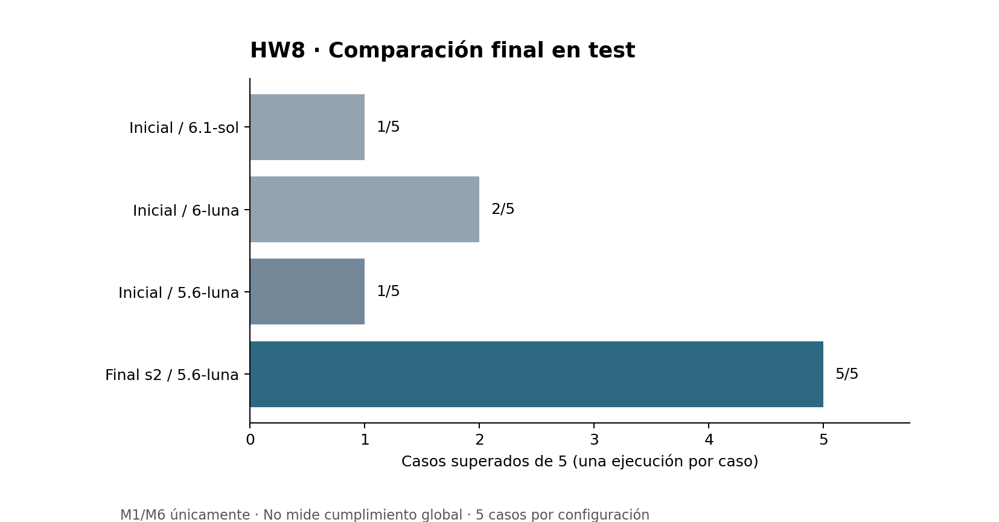

# Vanker Invest | Evaluación de IA conversacional en un contexto financiero regulado

**Caso de estudio de Content Design, evaluación de agentes y gobernanza de contenido.**

> **Proyecto ficticio y educativo.** Vanker Invest es un prototipo de asistente para consultar productos de inversión ficticios. No gestiona dinero, no recomienda inversiones personalizadas, no tramita derivaciones reales y no utiliza datos de clientes. **No es un producto desplegado ni una certificación de cumplimiento regulatorio.**

## En 60 segundos

En una muestra etiquetada de 114 conversaciones de prueba del prototipo inicial, **65 mostraban un fallo de comunicación**: el asistente presentaba una derivación a una persona como una operación existente o realizada, aunque el sistema solo simulaba esa función.

Probé tres intervenciones independientes para corregir la redacción: **prompt, descripción/resultado de herramienta y construcción del contexto (*harness*)**. Las tres superaron los tres casos del fallo objetivo en desarrollo, pero no todas conservaron el resto del comportamiento. Las descarté como versiones finales por regresiones observadas o defectos editoriales. Posteriormente, un proceso de búsqueda acotado generó dos candidatos de prompt. El segundo, **s2**, fue conservado como configuración experimental de cierre.

En la comparación final, con **el mismo modelo `gpt-5.6-luna`**, el agente inicial pasó **1 de 5 casos** y s2 pasó **5 de 5 casos**. El coste de ejecución estimado pasó de **0,07284 a 0,07030 USD por 100 conversaciones equivalentes** (sin el coste del juez). **Cinco casos evaluados una vez cada uno no son una estimación de fiabilidad ni acreditan calidad global.** Se identificaron, además, **dos incumplimientos editoriales conocidos** que el score M1/M6 no detectaba y que permanecen abiertos.

## Mi contribución como Content Designer

- **Definición del comportamiento esperado:** traducir los límites de un asistente financiero educativo a reglas de respuesta observables.
- **Diseño de la evaluación:** seleccionar un riesgo de comunicación, establecer casos, criterios y un control de regresión complementario.
- **Evaluación de alternativas:** comparar cambios en capas distintas sin atribuir causalidad a ejecuciones únicas.
- **Criterio editorial y decisión humana:** rechazar correcciones que pasaban el criterio limitado pero tenían defectos en las respuestas; aceptar s2 solo como cierre experimental con incidencias conocidas.
- **Gobernanza:** separar el veredicto del juez, la lectura del agente de codificación y las decisiones confirmadas por una persona; conservar procedencia, versiones y limitaciones.

La construcción y ejecución del código de soporte se realizó con asistencia de un agente de codificación. **No atribuyo al Content Designer la autoría manual de todo el código ni presento las lecturas asistidas como revisiones humanas independientes.**

## Resultados seleccionados

| Configuración | Modelo | Casos superados (test) | Coste agente / 100 conversaciones (USD) |
|---|---|---:|---:|
| Inicial | `gpt-6.1-sol` | 1/5 | 0,64980 |
| Inicial | `gpt-6-luna` | 2/5 | 0,029216 |
| Inicial | `gpt-5.6-luna` | **1/5** | **0,07284** |
| Final s2 | `gpt-5.6-luna` | **5/5** | **0,07030** |

La comparación entre configuraciones **3 y 4** mantiene fijo el modelo y cambia el prompt. No se deben interpretar comparaciones entre los cuatro modelos como pruebas generales de calidad de cada modelo.

## Qué demostró y qué no

**Demostró, dentro del conjunto de prueba:** capacidad para detectar un fallo específico, construir un evaluador especializado, ensayar cambios y registrar resultados y decisiones reproducibles desde los datos seleccionados.

**No demostró:** precisión sobre población independiente, cumplimiento de todas las reglas editoriales, funcionamiento en producción, eficacia de una derivación real, ausencia de fallos fuera de los modos M1/M6 o revisión humana individual de todas las trazas.

## Explorar el caso

1. [Contexto y mi rol](case-study/01-contexto-y-rol.md)
2. [Del riesgo de contenido a los criterios de evaluación](case-study/02-comportamiento-y-evaluacion.md)
3. [Intervenciones, regresión y resultados](case-study/03-experimento-y-resultados.md)
4. [Decisiones, hallazgos y límites](case-study/04-decisiones-y-limitaciones.md)
5. [Índice de evidencias verificables](evidence/indice-de-evidencias.md)
6. [Cómo recalcular los datos publicados sin API](reproducibility/README.md)

## Procedencia y alcance de este repositorio

Este repositorio es una **selección editorial nueva** basada en los artefactos documentados en `joseluisescuadravalle/Vanker_Invest`, rama `main`, commit **`31920725ed1555cb417f1a3fdda1ce44fb526bbd`**. Contiene tablas de datos **derivadas y transcritas de los registros originales**; no copia el corpus completo de trazas, prompts, conversaciones, credenciales, configuraciones operativas ni el historial del repositorio de desarrollo. Véase [procedencia y hashes originales](evidence/procedencia.md).

**Nota sobre enlaces de origen:** el repositorio de trabajo podría pasar a privado. Sus enlaces pueden dejar de funcionar para lectores externos; este caso conserva los resúmenes y los datos necesarios para verificar los cálculos publicados **sin depender de acceso al repositorio original**. Los checks internos no certifican por sí solos la autenticidad de las ejecuciones históricas, que dependen de los artefactos de origen documentados.

**Estado de revisión de seguridad:** esta versión de portfolio contiene una selección pequeña de datos no sensibles aparentes; el escaneo exhaustivo del repositorio histórico y su historial queda fuera de esta entrega. Véase [SECURITY.md](SECURITY.md).

**Idioma:** el caso de estudio está en español. *English summary: an educational Content Design case study on evaluating a fictional investment assistant, comparing prompt/tool/harness interventions, measuring bounded regression, documenting editorial gaps, and separating model-judge results from human decisions.*
